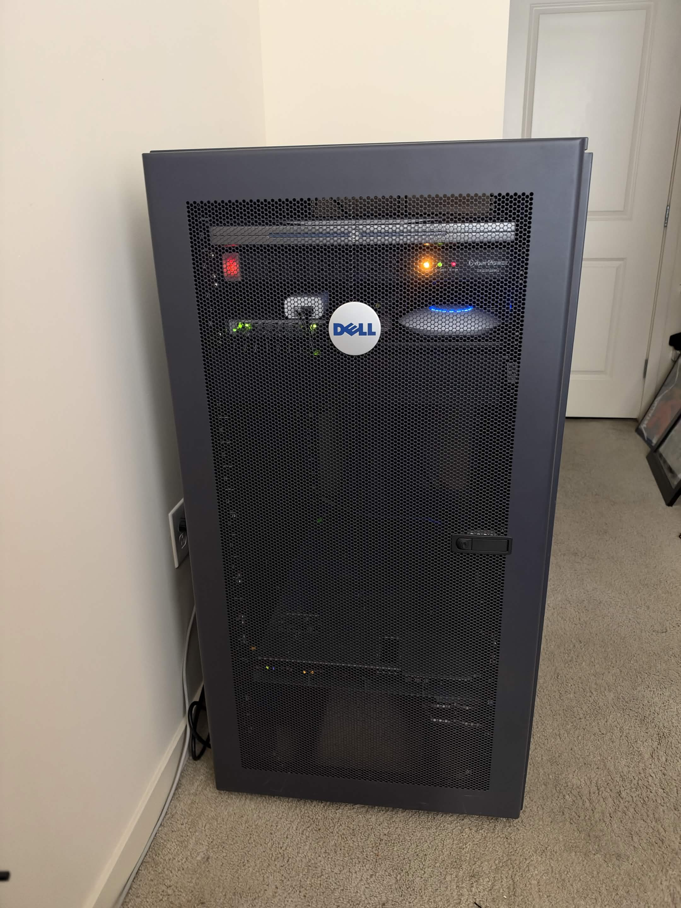
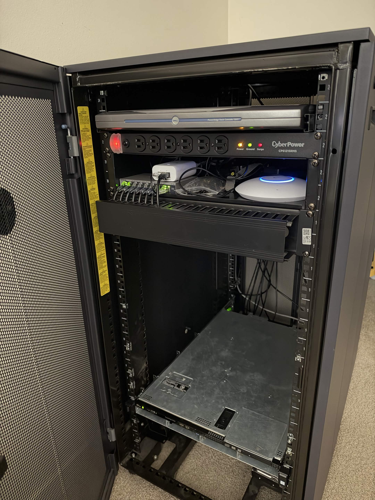
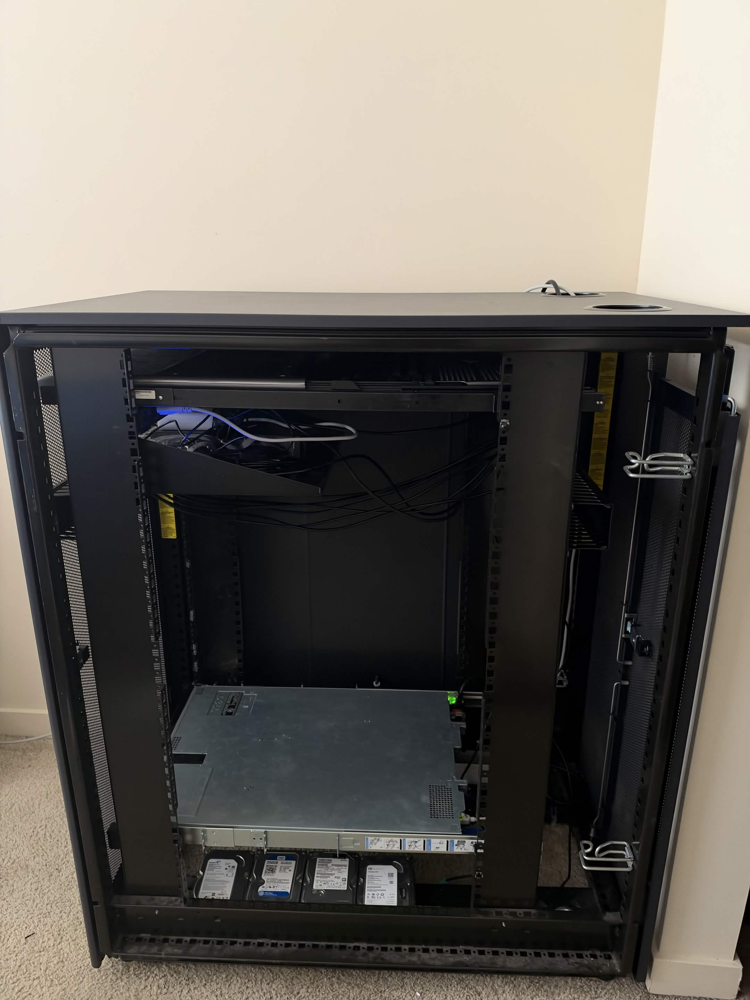
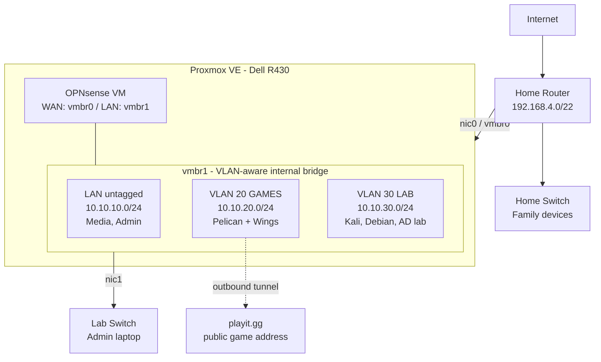

# Homelab

Self-hosted infrastructure and security lab: Proxmox on a Dell PowerEdge R430, OPNsense, segmented VLANs, zero open ports.

## Hardware

| Component | Details |
|---|---|
| Server | Dell PowerEdge R430 (1U), 128 GB RAM, 4x onboard 1 GbE NICs, iDRAC |
| Rack | Dell PowerEdge 2410 (24U, square-hole) |
| Rails | Dell A8 static ReadyRails |
| Console | Dell 15FP rack console (KMM tray) |
| Lab switch | Netgear GS108E (dedicated to the lab network) |
| Other | Raspberry Pi, horizontal cable management |

## Photos

| Closed | Front open | Side open |
|---|---|---|
|  |  |  |

## Architecture

The home network has no route into the lab. Everything in the lab sits behind OPNsense, and each VLAN is filtered separately.

The game server and attack lab can reach the internet, but not each other, the home network, the Proxmox host, or the OPNsense management interface.

## Firewall Policy

Default deny between all segments.

| From / To | Internet | LAN | GAMES | LAB | Home network | Proxmox host | OPNsense GUI |
|---|---|---|---|---|---|---|---|
| LAN | Yes | Yes | Yes | Yes | No | Yes | Yes |
| GAMES | Yes | No | - | No | No | No | No |
| LAB | Yes | No | No | - | No | No | No |

GAMES and LAB can reach OPNsense for DHCP and DNS only.

## Virtual Machines

| VM | OS | Network | Resources | Role |
|---|---|---|---|---|
| opnsense | OPNsense 26.7 (FreeBSD) | vmbr0 + vmbr1 | 4c / 8 GB | Firewall, router, DHCP, DNS |
| pelican | Debian 13 | GAMES (VLAN 20) | 8c / 32 GB | Pelican Panel + Wings (Docker) |
| kali-lab | Kali Linux | LAB (VLAN 30) | 2c / 4 GB | Kali Linux test lab |
| debian-lab | Debian 13 | LAB (VLAN 30) | 2c / 4 GB | Linux test lab |
| arrstack | Debian 13 + Docker | LAN | 8c / 32 GB | Media server behind a VPN kill switch |

## Game Server

The game server runs on [Pelican](https://pelican.dev), a panel that runs each server in its own Docker container.

- Public access through a [playit.gg](https://playit.gg) outbound tunnel, so no port forwarding is needed
- Whitelist only

